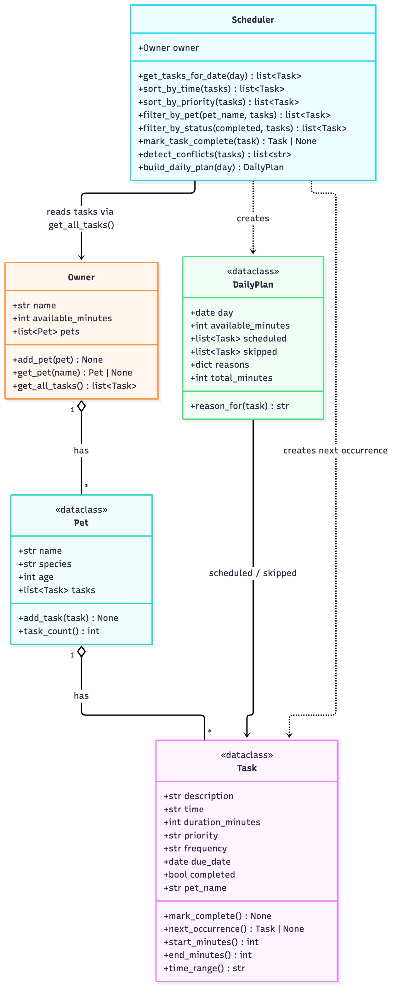

# PawPal+ (Module 2 Project)

**PawPal+** is a Streamlit app that helps a busy pet owner plan care tasks (walks, feeding, meds, grooming, appointments) across all of their pets. It sorts the day's tasks, warns about clashes, rolls recurring tasks forward automatically, and builds a daily plan that fits the owner's available time, with a reason for every choice.

## Scenario

A busy pet owner needs help staying consistent with pet care. They want an assistant that can:

- Track pet care tasks (walks, feeding, meds, enrichment, grooming, etc.)
- Consider constraints (time available, priority, owner preferences)
- Produce a daily plan and explain why it chose that plan

## ✨ Features

- **Multiple pets per owner**: every scheduling feature works across all pets via `Owner.get_all_tasks()`.
- **Sorting by time**: tasks are listed chronologically (date, then `HH:MM`).
- **Priority sorting**: high → medium → low, ties broken by time.
- **Filtering**: by pet and by status (to do / done).
- **Daily and weekly recurrence**: completing a repeating task automatically schedules the next one (tomorrow or next week).
- **Conflict warnings**: overlapping time windows (not just identical start times) are flagged with a clear message, never a crash.
- **Time-budget daily plan**: fits today's to-do tasks into the owner's available minutes, highest priority first, and explains why each task was scheduled or skipped.
- **Input validation**: bad times (`"9:00"`, `"25:00"`), unknown priorities/frequencies, and non-positive durations are rejected with a helpful error.
- **Readable output**: an aligned CLI table in `main.py`, and color-coded priority badges and status icons in the UI.

## Implementation summary

All logic lives in `pawpal_system.py` (the logic layer). The UI (`app.py`) and the CLI demo (`main.py`) only call into it.

- **`Task`** (dataclass): one care activity, with description, `"HH:MM"` time, duration, priority, frequency (`once`/`daily`/`weekly`), due date, completion status, and the name of the pet it belongs to. It knows how to mark itself complete, produce its next occurrence, and report its time window.
- **`Pet`** (dataclass): pet details plus its list of tasks. `add_task()` attaches a task and tags it with the pet's name.
- **`Owner`**: the owner's name, their daily time budget (`available_minutes`), and their pets. `get_all_tasks()` returns every pet's tasks as one list.
- **`Scheduler`**: the "brain". It takes an `Owner` and always reads tasks through `Owner.get_all_tasks()`, then sorts, filters, completes, checks conflicts, and plans.
- **`DailyPlan`** (dataclass): the result of `Scheduler.build_daily_plan()`, holding scheduled tasks, skipped tasks, a reason per task, and total minutes used.

The UML lives in [`diagrams/uml_final.mmd`](diagrams/uml_final.mmd) (`diagrams/uml.mmd` is kept identical):



## Getting started

### Setup

```bash
python -m venv .venv
source .venv/bin/activate  # Windows: .venv\Scripts\activate
pip install -r requirements.txt
```

### Run it

```bash
python main.py          # CLI demo
streamlit run app.py    # web UI (opens http://localhost:8501)
python -m pytest        # test suite
```

## 🖥️ Sample Output

Output of `python main.py` (dates reflect the day it was run):

```
Today's Schedule for Jordan (sorted by time)
=============================================
  Oct 18 07:30  Mochi  Morning walk      30 min  [high]    daily   todo
  Oct 18 08:00  Luna   Breakfast         10 min  [high]    daily   todo
  Oct 18 08:00  Luna   Give medication    5 min  [high]    daily   todo
  Oct 18 14:00  Mochi  Vet appointment   45 min  [medium]  once    todo
  Oct 18 18:30  Mochi  Evening walk      30 min  [medium]  daily   todo
  Oct 18 19:00  Luna   Brush coat        15 min  [low]     weekly  todo

Mochi's tasks (filter_by_pet)
-----------------------------
  Oct 18 07:30  Mochi  Morning walk      30 min  [high]    daily   todo
  Oct 18 14:00  Mochi  Vet appointment   45 min  [medium]  once    todo
  Oct 18 18:30  Mochi  Evening walk      30 min  [medium]  daily   todo

Conflict check (detect_conflicts)
---------------------------------
  WARNING: Conflict on 2026-10-18: Luna 'Breakfast' and Luna 'Give medication' (both start at 08:00)

Recurring task (mark_task_complete)
-----------------------------------
  Completed 'Morning walk' due 2026-10-18
  Next 'Morning walk' automatically created for 2026-10-19

Completed tasks (filter_by_status)
----------------------------------
  Oct 18 07:30  Mochi  Morning walk      30 min  [high]    daily   done

Still to do (filter_by_status)
------------------------------
  Oct 18 08:00  Luna   Breakfast         10 min  [high]    daily   todo
  Oct 18 08:00  Luna   Give medication    5 min  [high]    daily   todo
  Oct 18 14:00  Mochi  Vet appointment   45 min  [medium]  once    todo
  Oct 18 18:30  Mochi  Evening walk      30 min  [medium]  daily   todo
  Oct 18 19:00  Luna   Brush coat        15 min  [low]     weekly  todo
  Oct 19 07:30  Mochi  Morning walk      30 min  [high]    daily   todo

Today's plan: 90/90 min (build_daily_plan)
---------------------------------------------
  Oct 18 08:00  Luna   Breakfast         10 min  [high]    daily   todo
      why: high priority; fits in budget (10/90 min used)
  Oct 18 08:00  Luna   Give medication    5 min  [high]    daily   todo
      why: high priority; fits in budget (15/90 min used)
  Oct 18 14:00  Mochi  Vet appointment   45 min  [medium]  once    todo
      why: medium priority; fits in budget (60/90 min used)
  Oct 18 18:30  Mochi  Evening walk      30 min  [medium]  daily   todo
      why: medium priority; fits in budget (90/90 min used)
  SKIPPED Luna 'Brush coat': low priority; needs 15 min but only 0 min left
```

## 🧪 Testing PawPal+

```bash
# Run the full test suite (from the project root, with .venv activated):
python -m pytest
```

`pytest.ini` puts the project root on the import path, so plain `pytest` works too.

**`tests/test_pawpal.py`** (logic layer, 25 tests) covers:

- **Core classes**: `mark_complete()` flips status, `Pet.add_task()` increases the task count and tags the pet, and `Owner.get_all_tasks()` combines every pet's tasks. Invalid input (e.g. `"9:00"`, unknown priority, zero duration) is rejected.
- **Sorting**: tasks come back in chronological order (date first, then time), and priority sort puts high before medium before low, breaking ties by time.
- **Filtering**: by pet name and by completion status, including an unknown pet.
- **Recurrence**: completing a daily task creates a new one due tomorrow; weekly creates one due in 7 days; one-off tasks create nothing; completing twice doesn't duplicate; an overdue daily task rolls forward from today.
- **Conflict detection**: same start time across pets, overlapping durations, and no false alarms for back-to-back tasks, different days, or completed tasks.
- **Daily plan**: respects the time budget, keeps high-priority tasks first, explains skipped tasks, and only plans today's pending tasks.
- **Edge cases**: an owner whose pets have no tasks yields empty sorts, no conflicts, and an empty plan.

**`tests/test_app.py`** (UI, 5 tests) drives `app.py` end to end with Streamlit's `AppTest`. It adds pets and tasks through the forms, rejects a duplicate pet, checks the sorted table and conflict warning, completes a daily task and sees its next occurrence, and generates a budgeted plan with reasons.

Sample test output:

```
============================= test session starts ==============================
platform darwin -- Python 3.12.13, pytest-9.1.1, pluggy-1.7.0
rootdir: /Users/norazgulyyev/Downloads/Codepath/ai110-module2show-pawpal-starter
configfile: pytest.ini
testpaths: tests
plugins: anyio-4.15.1
collected 30 items

tests/test_app.py .....                                                  [ 16%]
tests/test_pawpal.py .........................                           [100%]

============================== 30 passed in 1.05s ==============================
```

**Confidence level: ★★★★☆ (4/5).** Every scheduling rule has passing happy-path and edge-case tests, and the UI workflow is exercised end to end. I'm holding back one star for cases the model doesn't handle yet: tasks that run past midnight aren't compared against the next day's tasks, there's no editing/deleting of tasks in the UI, and data isn't saved between app sessions.

## 📐 Smarter Scheduling

All scheduling logic lives on `Scheduler` in `pawpal_system.py` and reads tasks through `Owner.get_all_tasks()`, so it works across every pet.

| Feature | Method(s) | Notes |
|---------|-----------|-------|
| Task sorting (time) | `Scheduler.sort_by_time()` | `sorted()` with `key=lambda t: (t.due_date, t.time)`. Zero-padded `"HH:MM"` strings sort correctly as text, and `Task` validates that format on creation. |
| Task sorting (priority) | `Scheduler.sort_by_priority()` | High → medium → low via a `PRIORITY_RANK` lookup, ties broken by time. |
| Filtering | `Scheduler.filter_by_pet()`, `Scheduler.filter_by_status()`, `Scheduler.get_tasks_for_date()` | Filter by pet name, done/not done, or due date. Filters accept an optional task list, so they can be chained. |
| Conflict handling | `Scheduler.detect_conflicts()` | Compares every pair of *pending* tasks on the same date and flags any whose `[start, start + duration)` windows overlap, which includes exact same-time clashes. Returns warning strings instead of raising, so the app never crashes on a clash. |
| Recurring tasks | `Scheduler.mark_task_complete()`, `Task.next_occurrence()` | Completing a `daily` or `weekly` task automatically adds a fresh copy to the same pet, due today + 1 or + 7 days (`timedelta`). Completing a task twice doesn't create duplicates. |
| Time-budget plan *(Challenge 1 + 3)* | `Scheduler.build_daily_plan()` → `DailyPlan` | Takes today's pending tasks in priority order and keeps each one that still fits in `Owner.available_minutes`. The result lists scheduled tasks (in time order), skipped tasks, and a one-line reason for every decision. |

## 📸 Demo Walkthrough

Run `streamlit run app.py`. The page has four sections, top to bottom:

1. **👤 Owner**: set the owner's name and **Minutes available today** (the time budget the planner must respect, e.g. `45`).
2. **🐶 Pets**: fill in name, species, and age, then click **Add pet**. This calls `Owner.add_pet()`. Add `Mochi` (dog) and `Luna` (cat). The pet table updates immediately and shows each pet's task count. Adding a second "Mochi" shows an error instead of creating a duplicate. The owner object lives in `st.session_state`, so nothing is lost when the page reruns.
3. **📋 Tasks: add**: pick a pet, then enter a task, time, duration, priority, and how often it repeats. Click **Add task** (calls `Pet.add_task()`). For example: Mochi "Morning walk" 07:30 / 30 min / high / daily; Luna "Breakfast" 08:00 / 10 min / high / daily; Luna "Medication" 08:00 / 5 min / high / once; Mochi "Evening walk" 18:30 / 30 min / medium / daily; Luna "Brush coat" 19:00 / 15 min / low / weekly. Tasks can be entered in any order.
4. **📋 Tasks: view**: the task table is always sorted (`Scheduler.sort_by_time()`, or **Sort by → Priority** for `sort_by_priority()`) and can be narrowed with **Show pet** (`filter_by_pet()`) and **Status** (`filter_by_status()`). Priorities show as 🔴/🟡/🟢 badges and status as ⏳/✅.
5. **Conflict warnings**: because Breakfast and Medication both start at 08:00, a yellow `st.warning` appears under the table: *"Conflict on …: Luna 'Breakfast' and Luna 'Medication' (both start at 08:00). Consider moving one of these tasks."* With no clashes, a green "No scheduling conflicts" message is shown instead.
6. **Complete a task**: choose "Morning walk" in **Mark a task complete** and click **Complete ✔**. The task moves to *done*, and because it repeats daily, an info message confirms the next one was added for tomorrow (`Scheduler.mark_task_complete()`).
7. **🗓️ Today's Schedule**: click **Generate schedule** (`Scheduler.build_daily_plan()`). A green summary shows minutes used vs. available. The table lists the chosen tasks in time order with a **why** column ("high priority; fits in budget (10/45 min used)"). Each task that didn't fit gets an info line. With a 45-minute budget, Breakfast, Medication, and the Evening walk use all 45 minutes, so you see *"⏭️ Skipped Luna's 'Brush coat': low priority; needs 15 min but only 0 min left."* The plan also repeats the warning that Breakfast and Medication overlap. The plan stays visible and updates live as you change tasks or the budget.

The same behaviors in the terminal (`python main.py`) are shown in [Sample Output](#️-sample-output) above: sorting, a pet filter, the 08:00 conflict warning, the daily recurrence, status filters, and the budgeted plan with a skipped low-priority task.
